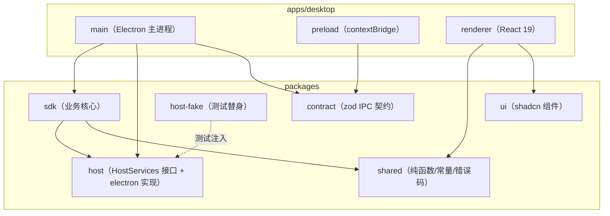

# 破坏性重构计划（dev 分支）

目标：把 4.5 的 Electron 单体（`main.js` 5108 行 + `src/` 手写 JS/JSX + 103 个自研 check 脚本）重构为
**pnpm workspace 多包 + TypeScript 7 + React 19 + Vite 8 + Biome + shadcn/Tailwind v4** 的工程，
抽出可独立测试的 SDK，并把测试体系换成分层结构。仍然只做 Electron 桌面端。

本文件是执行依据：先落地本文，再按 M0–M5 执行，执行结果回填到第 16 节。

---

## 1. 目标与非目标

### 目标

1. pnpm workspace 多包：`apps/desktop` + `packages/{shared,contract,host,host-fake,sdk,ui}`。
2. 全量 TypeScript（`tsc -b` 跨包类型检查 + 声明产出）。
3. 渲染层 React 19 + Vite 8 + Tailwind v4 + shadcn，视觉沿用 `DESIGN.md` token。
4. 抽取 SDK：统一方法覆盖搜索、联想、目录、剧集、播放、弹幕、评论、账号、媒体产物。
5. 依赖注入：宿主能力（app/window/session/protocol/fs/ffmpeg/clock/logger）走 `HostServices` 接口，
   测试注入 `host-fake`，消除 46 个脚本各自手写假 Electron 的重复。
6. 分层测试：L1 纯逻辑 / L2 装配层 / L3 组件 / L4 真实 Electron E2E / L5 媒体正确性。
7. 删除历史包袱：旧单体、旧手写渲染层、旧 check 脚本、旧构建产物、双锁文件。

### 非目标（本次不做）

- 不做移动端、不做 Web 端、不做服务端。
- 不重写已验证的逆向/解密/合并算法 —— **原样迁移 + 类型壳**，只换工程化外壳。
- 不做账号登录参与取流（登录态仍只读云端观看记录，接口预留 `identity` 注入点）。
- 不做发行（不构建安装包、不签名、不公证、不打 tag）。

---

## 2. 决策记录

### 2.1 版本矩阵（均为 2026 年 npm 实测最新）

| 角色          | 包                                                        | 版本    |
| ------------- | --------------------------------------------------------- | ------- |
| 包管理        | pnpm（workspace）                                         | 12.x    |
| 语言          | typescript                                                | 7.0.2   |
| 运行时        | electron                                                  | 45.1.0  |
| UI            | react / react-dom                                         | 19.3.1  |
| 类型          | @types/react / @types/react-dom                           | 19.3.x  |
| 构建          | vite                                                      | 8.3.5   |
| Electron 构建 | electron-vite                                             | 6.0.0   |
| 样式          | tailwindcss + @tailwindcss/vite                           | 4.3.3   |
| 组件          | shadcn（CLI，MIT）                                        | 4.x     |
| Lint/Format   | @biomejs/biome                                            | 2.6.4   |
| 测试          | vitest                                                    | 5.0.5   |
| 契约          | zod                                                       | 4.6.7   |
| 远端状态      | @tanstack/react-query                                     | 5.105.0 |
| 本地状态      | zustand                                                   | 5.0.16  |
| 基础原语      | radix-ui                                                  | 1.8.1   |
| 其他          | tailwind-merge 3.7 / cva 0.7 / lucide-react 1.64 / sonner |         |
| 打包          | electron-builder 26.18 / electron-updater 6.8.11          |         |

### 2.2 TypeScript 7 的硬约束（已核实包内容）

`typescript@7.0.2`：`bin` 只有 `{ tsc: "bin/tsc" }`，`exports` 只有 `.` 与 `./unstable/*`，
**没有 `lib/typescript.js`**（无稳定 programmatic API）。

- 不可使用：`typescript-eslint`、`api-extractor`、`vite-plugin-dts`、`ts-morph`、`ts-node`。
- 可使用：project references、`composite`、`--build`、`--incremental`、`declarationMap`。
- `.d.ts` 由 `tsc -b --emitDeclarationOnly` 产出，**不用 vite-plugin-dts**。
- 选 Biome 的理由之一：它不依赖 TS Compiler API，正好绕开该限制。

### 2.3 已定项

| 项            | 决定                                                                                            |
| ------------- | ----------------------------------------------------------------------------------------------- |
| Electron      | 用最新 45.1.0                                                                                   |
| 登录          | 留 `identity` 注入点，暂不参与取流；`getCapabilities()` 暴露 `accountAffectsPlayback: false`    |
| 搜索联想      | 接入逆向到的 `https://hongguoduanju.com/api/search/suggestion/?query=<kw>`，本地联想作 fallback |
| 状态管理      | TanStack Query（远端）+ zustand（本地）                                                         |
| 旧 check 脚本 | 保留运行到 M4，之后按域替换；不一次性迁移                                                       |
| SDK 分发      | 仓库内私有包（不发布）                                                                          |

### 2.4 逆向结果：搜索联想接口

- 端点 `GET https://hongguoduanju.com/api/search/suggestion/?query=<关键词>`
- 无签名、无 Cookie、无需伪装 UA；`query` ≤ 30 字符且非空，否则 `{code:"invalid_query"}`
- 固定返回 10 条；`count/limit/offset/aid` 被忽略；未知参数报错（服务端参数白名单）
- 条目：`word_type`（`short_play_name` | `common_query`）、`name`、`keyword`、`display_words[]`、`video_data{}`
  - `short_play_name`：`keyword` 实为 `series_id`（19 位大整数，须字符串化）；`video_data` 含
    `series_id/episode_cnt/series_title/series_intro/series_cover/episode_right_text/vid_list/hot_score_data/category_list/celebrities`
  - `common_query`：`keyword` 为 `1_<hash>`，`video_data` 为空
- 降级：失败/超时回落本地联想（搜索历史 + 浏览过剧名）

---

## 3. 架构总览



依赖铁律：
- `sdk` / `shared` 不得 import `electron`。
- `contract` 只依赖 `zod` + `shared`。
- `renderer` 不得 import `electron` 或 `host`。
- `host-fake` 只在测试中使用。

---

## 4. 目标目录结构

```
/
  package.json               # private root，workspace 脚本
  pnpm-workspace.yaml
  biome.json
  tsconfig.base.json
  tsconfig.json              # 仅 references
  apps/desktop/
    package.json
    electron.vite.config.ts
    tsconfig.json
    index.html
    electron-builder.yml
    src/main/                # 主进程
    src/preload/             # preload
    src/renderer/            # React 19
  packages/{shared,contract,host,host-fake,sdk,ui}/
  tooling/legacy-checks/     # M4 前保留的旧 check 运行器
  fixtures/                  # 上游响应与媒体夹具
  docs/refactor-plan.md
```

---

## 5. 包职责

| 包          | 职责             | 关键内容                                                                                                                                                            |
| ----------- | ---------------- | ------------------------------------------------------------------------------------------------------------------------------------------------------------------- |
| `shared`    | 无依赖纯逻辑     | 错误码、质量策略、标题归一化与排序、文件名/路径规则、时间格式化                                                                                                     |
| `contract`  | IPC 契约单一真源 | zod schema（请求/响应/事件），导出推导类型                                                                                                                          |
| `host`      | 宿主能力接口     | `HostServices`（app/window/session/protocol/dialog/fs/ffmpeg/clock/logger/secretStore/media）                                                                       |
| `host-fake` | 测试替身         | 内存 window/session/protocol、假时钟、可编程故障注入                                                                                                                |
| `sdk`       | 业务核心         | providers（hongguo-app / hongguo-web / passport / xifan / hema / custom）+ services（search/catalog/series/playback/danmaku/comments/export/account/history/media） |
| `ui`        | 组件             | shadcn 组件 + Tailwind preset + 设计 token                                                                                                                          |

---

## 6. SDK 公共 API

`createSdk(config): Sdk`

config：`{ host, proxy?, cache?, timeout?, logger?, secretStore?, identity?, fixtures? }`

| 域       | 方法                                                                                                                                                     |
| -------- | -------------------------------------------------------------------------------------------------------------------------------------------------------- |
| 搜索     | `suggest(keyword)`、`search(keyword, {sources,page,cursor})`、`searchMore(...)`、`searchBySource(...)`                                                   |
| 目录     | `listSources()`、`setSourceEnabled()`、`browseCategories()`、`browseList({source,category,genre,cursor,page})`、`rankings({kind,page})`、`newReleases()` |
| 剧集     | `resolveInput(input)`、`getSeries(id)`、`getEpisode(id,vid)`、`getDetails(id)`、`findSequels(id)`                                                        |
| 播放     | `getPlaybackSources(vid,{seriesId,quality})`、`getPlaybackUrl(...)`、`openMediaStream(...)`、`prepareHls(...)`、`transcodeForCompat(...)`                |
| 弹幕评论 | `getDanmaku(...)`、`getComments(...)`、`getReviews(...)`、`exportText(...)`                                                                              |
| 账号     | `account.status/startLogin/pollLogin/cancelLogin/logout/signIn/getCloudHistory/resolveCloudProgress/onExpired`                                           |
| 用户数据 | `getProgress/saveProgress/listHistory/removeHistory`                                                                                                     |
| 媒体产物 | `downloadEpisode(...)`、`planMerge(...)`、`mergeSeries(...)`、`deleteSeriesFiles(...)`                                                                   |
| 能力     | `getCapabilities()`                                                                                                                                      |

统一约定：`Result` 信封 `{ok,data,error,meta}`；游标不透明；`timeoutMs` + `AbortSignal`；
错误码枚举；缓存可关；`meta.timing/attempts/cache/via`。

---

## 7. 迁移映射

| 旧                                                                                                                                                         | 新                                                                                           |
| ---------------------------------------------------------------------------------------------------------------------------------------------------------- | -------------------------------------------------------------------------------------------- |
| `main.js` 的 IPC 段                                                                                                                                        | `apps/desktop/src/main/ipc/*` + `packages/contract`                                          |
| `main.js` 的队列/合并/协议段                                                                                                                               | `packages/sdk/src/services/media` + `apps/desktop/src/main/{stream-protocol,download-queue}` |
| `preload.js`                                                                                                                                               | `apps/desktop/src/preload/index.ts`（类型来自 contract）                                     |
| `src/native/app-source.js`                                                                                                                                 | `packages/sdk/src/providers/hongguo-app/ticket.ts`                                           |
| `src/native/playback-device.js`                                                                                                                            | `.../hongguo-app/device.ts`                                                                  |
| `src/native/hongguo.js`                                                                                                                                    | `.../hongguo-web/player.ts`                                                                  |
| `src/native/hongguo-search.js`                                                                                                                             | `.../hongguo-web/search.ts`                                                                  |
| `src/native/hongguo-app-search.js` / `-catalog` / `-new`                                                                                                   | `.../hongguo-app/{search,catalog,new-releases}.ts`                                           |
| `src/native/account-session.js`                                                                                                                            | `packages/sdk/src/services/account/*` + `.../providers/hongguo-passport`                     |
| `src/native/{xifan,hema,custom-source}.js`                                                                                                                 | `packages/sdk/src/providers/{xifan,hema,custom}/*`                                           |
| `src/native/{danmaku,danmaku-sign,episode-comments}.js`                                                                                                    | `packages/sdk/src/services/{danmaku,comments}`                                               |
| `src/native/{decrypt-worker.cjs,merge-runner,merge-plan,hls-media,download-quality}.js`                                                                    | `packages/sdk/src/services/media/*`                                                          |
| `src/native/{web-media-guard,catalog,public-details,series-search,watch-history,text-export,media-sources,portable-data,app-announcements,app-update*}.js` | 对应 `packages/sdk/src/**`（按域）                                                           |
| `src/store.js`                                                                                                                                             | `packages/sdk/src/services/storage` + host 注入的 JSON 存储                                  |
| `src/components/*.jsx`                                                                                                                                     | `apps/desktop/src/renderer/**`（重建）                                                       |
| `src/*.mjs` 模型                                                                                                                                           | `packages/shared` 或 renderer `lib/`（TS 化）                                                |
| `scripts/check-*.cjs`                                                                                                                                      | `tooling/legacy-checks`（M4 前运行）→ `packages/*/test`                                      |
| `vite.config.js` / `index.html`                                                                                                                            | `apps/desktop/electron.vite.config.ts` / `apps/desktop/index.html`                           |

---

## 8. 设计 token → Tailwind v4

`DESIGN.md` 的 token 落到 `@theme inline`：

| token                             | 值                                                            |
| --------------------------------- | ------------------------------------------------------------- |
| canvas                            | `#faf9f7`                                                     |
| sidebar                           | `#f0eeeb`                                                     |
| surface                           | `#ffffff`                                                     |
| text primary / secondary / muted  | `#252523` / `#686661` / `#77736c`                             |
| accent / accent-hover / selection | `#c8383d` / `#ae2b31` / `#fae9e7`                             |
| success / danger / border         | `#33745c` / `#ba3438` / `#e4e1dc`                             |
| 字体                              | macOS 系统 UI / PingFang SC；Windows fallback Microsoft YaHei |
| 字号                              | h 28/700 · body 13/400 · label 12/500 · caption 11            |
| 间距                              | 4/8/12/16/20/24/32；主内容左右 36                             |
| 尺寸                              | 侧栏 214 · 工具栏 48 · macOS 左上交通灯留白 58                |
| 圆角                              | 控件 7–9 · 海报 12 · 面板 16                                  |

必须手写保留（shadcn 不提供）：`-webkit-app-region: drag`、交通灯留白、侧栏 `user-select:none`、
reduced-motion、对话框 Escape/Tab 循环/焦点返回。

---

## 9. UI 页面与组件映射

页面（沿用现有导航）：发现短剧 · 热播推荐 · 搜索与下载 · 我的剧库 · 观看记录 · 收藏与上新 · 下载管理 · 红果账号 · 设置。

| 现在                  | 换成                                         |
| --------------------- | -------------------------------------------- |
| 侧栏导航              | `Sidebar`                                    |
| 弹窗                  | `Dialog` / `AlertDialog`                     |
| 批量菜单              | `DropdownMenu`                               |
| 设置分组              | `Tabs` + `Field` + `Switch` + `Select`       |
| 搜索联想 `<datalist>` | `Command` + `Combobox`（接 suggestion 接口） |
| 下载列表              | `Item` / `Table` + `Progress`                |
| 提示                  | `sonner`                                     |
| 占位                  | `Skeleton`                                   |

---

## 10. 测试策略（五层）

| 层  | 对象                                                         | 工具                                        |
| --- | ------------------------------------------------------------ | ------------------------------------------- |
| L1  | 纯逻辑（签名、SM3、spade、解析、排序、质量策略、merge-plan） | vitest(node)，零替身                        |
| L2  | IPC handler、队列、广播、持久化、协议注册                    | vitest(node) + `host-fake`，每 handler 一条 |
| L3  | 组件                                                         | vitest + Testing Library + jsdom            |
| L4  | preload 隔离、CSP、`hongguo-stream:`、画中画、落盘           | Playwright `_electron`（6–8 条）            |
| L5  | 解密、合并逐帧、HLS                                          | vitest + `fixtures/media`                   |

夹具统一放 `/fixtures/<provider>/<scenario>.json`，配 `loadFixture()`；媒体夹具不入库（`.gitignore`）。

---

## 11. 里程碑与出口条件

| M   | 内容                                       | 出口条件                                                      |
| --- | ------------------------------------------ | ------------------------------------------------------------- |
| M0  | 分支、workspace、质量门                    | `pnpm install` + `biome check` + `tsc -b` + `vitest run` 全绿 |
| M1  | `shared` / `sdk` 迁移                      | SDK 单测绿；provider 离线夹具跑通                             |
| M2  | `contract` / `host` / `host-fake` / 主进程 | 主进程可启动；L2 测试覆盖核心 handler                         |
| M3  | 渲染层重建                                 | `vite build` 通过；9 页可渲染                                 |
| M4  | 媒体接线（流协议、下载、合并、转码）       | 媒体单测绿；真实素材验收按 AGENTS.md                          |
| M5  | 打包配置                                   | `electron-builder --dir` 配置有效                             |

---

## 12. 清理清单（该删就删）

- `main.js`、`preload.js`、`src/**`、`scripts/**`、`vite.config.js`、根 `index.html`、`dist-react/**`
- `package-lock.json`、旧 `pnpm-lock.yaml`、`pnpm-workspace.yaml`（重建）
- `dist/**`（历史产物，未跟踪）
- 旧文档中的发行叙述保留，但 `PRODUCT.md` / `README.md` / `AGENTS.md` 需改为新结构
- 旧代码可回溯：`v4.5` 标签保留在 git 历史中

---

## 13. 风险

| 风险                                          | 缓解                                                             |
| --------------------------------------------- | ---------------------------------------------------------------- |
| Electron 44→45 行为变化（HEVC、协议、画中画） | M4 用真实素材回归；异常则回落 44.x 并记录                        |
| 迁移 provider 时破坏已验证算法                | 原样迁移 + 现有单测/夹具作为对账                                 |
| React 19 + jsdom 行为差异                     | 关键交互留给 L4 真实 Electron                                    |
| TS 7 工具链缺口                               | 只用 `tsc -b` + Biome + vitest，不引入依赖 TS API 的工具         |
| UI 重建规模大                                 | 核心页面优先，外围（隐身窗口、悬浮小窗、画质增强）列入待补齐清单 |

---

## 14. 许可（已解决）

2026-10-29：仓库所有者确认**拥有本项目全部代码的版权或已取得全体权利人许可**，据此将协议
由 GPL-3.0 变更为 **MIT**，已同步 `LICENSE`、`NOTICE`、`package.json(license)`、
文件头 `SPDX-License-Identifier` 与 `AGENTS.md`。上游署名与来源说明按署名惯例保留在 `NOTICE`。

## 15. 执行记录

分支 `dev`，版本 `5.0.0`。完整状态与交接见 [refactor-status.md](./refactor-status.md)。

### M0 骨架（完成）

| 命令 | 结果 |
|---|---|
| `pnpm install` | 8 个 workspace 项目 / 490 个包 |
| `npx tsc -b` | 0 error |
| `npx biome check .` | 0 error |
| `npx vitest run` | 5 文件 / 29 用例通过 |

偏差：
- pnpm 12 的 `onlyBuiltDependencies` 未生效，改用它自己生成的 `allowBuilds` 字段；
- Electron 45.1.0 二进制在 `--ignore-scripts` 安装后缺失，改为手动放入
  `node_modules/.pnpm/electron@45.1.0_*/node_modules/electron/{dist,path.txt}`。

### M1 SDK（核心完成，媒体编排未完成）

- 31 个 `src/native/*.js` 由 codemod 机械转成 ESM TypeScript，算法未改：
  `tooling/codemod-native-to-sdk.mjs` + `codemod-migration-fixes{,2,3}.mjs`。
- 迁移期类型策略：`packages/sdk/tsconfig.json` 放宽 `strict/noImplicitAny/strictNullChecks`，
  动态挂字段处显式 `any`；新写代码（suggest / facade / store）保持手写类型。
- `src/store.js` 重写为 `services/storage/store.ts`：保留原子写与读失败冻结语义，补类型 + 5 条用例。
- **新增能力**：`providers/hongguo-web/suggest.ts`（逆向的 `/api/search/suggestion`，含 HEIC 封面归一、
  19 位 id 字符串保留、`word_type` 分支、超时与错误码收敛），9 条离线用例。
- `facade.ts` 暴露 `createSdk`；`capabilities()` 如实标注 `accountAffectsPlayback: false`。
- 未迁入 SDK（保留在桌面端）：`floating-player-window`、`stealth-window`、`window-layout`、
  `renderer-security`、`media-access`。

### M2 契约 + 宿主 + 主进程（完成）

- `packages/contract`：zod 校验 + `channels.ts` 子路径（不引 zod），preload 产物 1.26 kB。
- `packages/host` 只有接口（无 electron 依赖）；Electron 实现在
  `apps/desktop/src/main/electron-host.ts`；`packages/host-fake` 提供内存替身与故障注入。
- `apps/desktop/src/main/ipc.ts` **不 import electron**，依赖全部注入，因此 7 条 L2 用例覆盖
  越权、入参校验、错误收敛、翻页默认值与通道完整性。这正是替代「46 个脚本 vm 跑 main.js +
  各自手写假 Electron」的结构。
- 修掉一个真实缺陷：沙箱 preload 不能解析 workspace 说明符，`externalizeDepsPlugin` 必须 exclude
  工作区包，否则启动即报 `module not found: @hongguo/contract`（冒烟测试发现）。

### M3 渲染层（竖切完成，页面未补齐）

- React 19 + TanStack Query + Tailwind v4 + shadcn 风格组件（`packages/ui`，落地 DESIGN.md token）。
- 可用页面：发现短剧（App 目录 + 换一批）、搜索与下载（联想下拉 + 官网搜索）、设置（读写 + 能力展示）。
- 其余 6 页显示「迁移中」并列出待迁条目，不假装功能存在。
- 产物：renderer 297 kB / CSS 14.25 kB / preload 1.26 kB / main 954 kB（含 SDK）。

### M4 / M5（未开始）

见 `docs/refactor-status.md` 的未完成清单。
